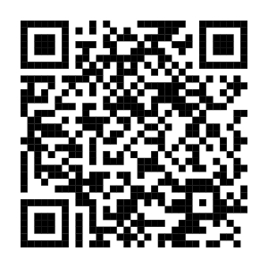
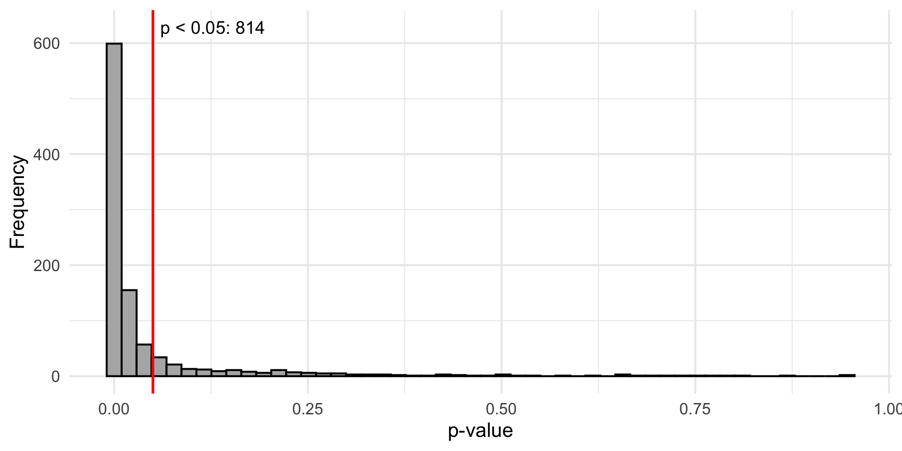
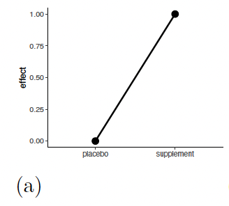
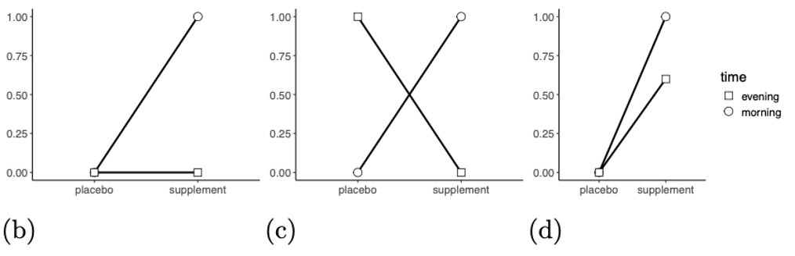
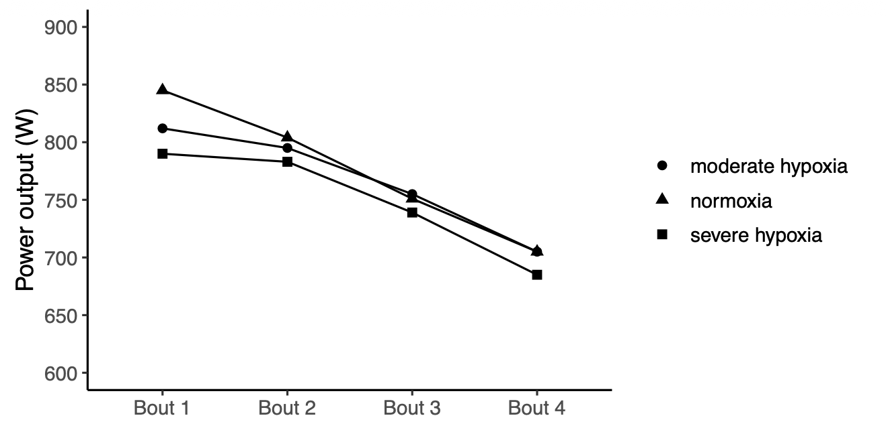
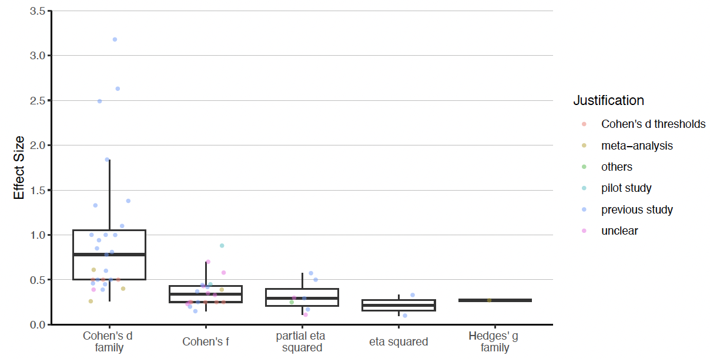
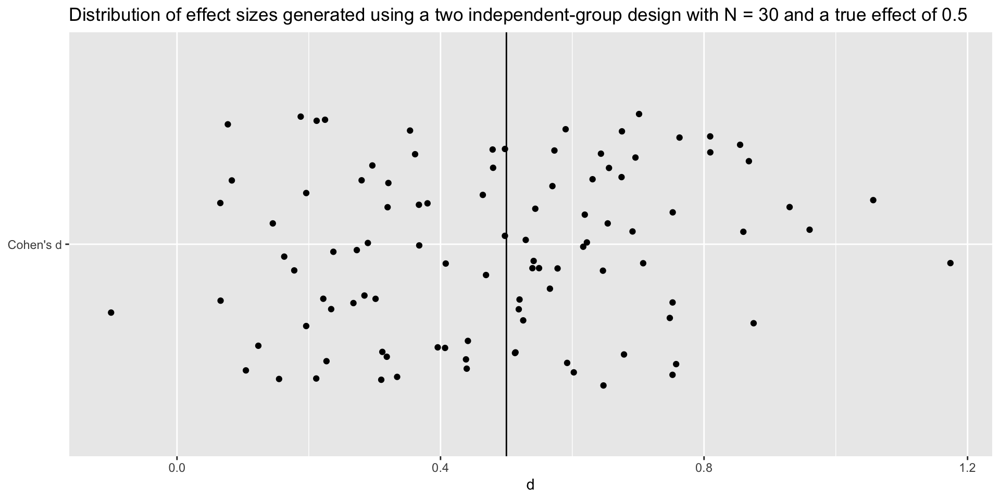
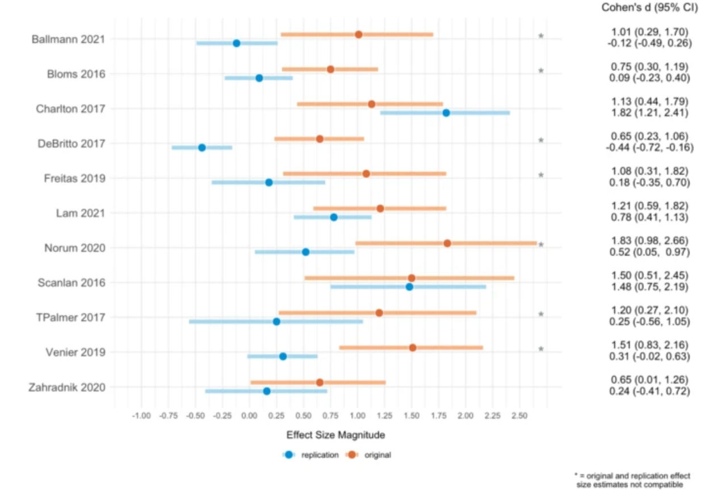

```{r, include=FALSE}
url <- "https://cristianmesquida.github.io/talk_in_Cologne/#/title-slide"
subtitle <- sprintf("[%s](%s)", url, url)
# make QR code
qrcode::qr_code(url) |> qrcode::generate_svg("images/qrcode.svg")
```

---
title: "From Guesswork to Rigor: Improving
Power Analyses in Research"
subtitle: German Sport University Cologne
author: "Cristian Mesquida"
date: today
format: 
  revealjs:
    theme: [dark, style.scss]
    transition: none
    transition-speed: fast
    syntax-highlighting: zenburn
    slide-number: true
bibliography: references.bib
---

```{r}
library(faux)
library(dplyr)
library(tidyr)
library(lme4)
library(lmerTest)
```

## Slides

{fig-align="center" width="200"}

## Talk's objectives

::: {.fragment fragment-index="1"}
- Increase awareness of the importance of conducting valid power analyses
:::

::: {.fragment fragment-index="2"}
- Provide some practical guidance on how to conduct a valid power analysis
:::

## Possible outcomes

|   | **Positive Result** | **Negative Result** |
|------------------------|------------------------|------------------------|
| **Effect Present (H₁)** | **True Positive** <br>Correct detection | **False Negative** <br>Type II Error ($\beta$) |
| **Effect Absent (H₀)** | **False Positive** <br>Type I Error ($\alpha$) | **True Negative** <br>Correct rejection |

## How to decrease the probability of a Type II error?

> By increasing the statistical power of the study design

> The power of a study is determined by the sample size, effect size, statistical test and alpha level

## Types of Power Analysis

::: {.column width="80%"}
- <i class="pt">**A Priori**</i>: calculates the <i class="ss">sample size</i> required to achieved a pre-specified <i class="power">power</i> for a pre-specified <i class="es">effect size</i>

- <i class="pt">**Sensitivity (Effect Size)**</i>: calculates the smallest <i class="es">effect size</i> required to detect a pre-specified <i class="ss">sample size</i> with a pre-specified <i class="power">power</i>

- <i class="pt">**Sensitivity (Power)**</i>: calculates <i class="power">power</i> given a pre-specified <i class="es">effect size</i> and <i class="ss">sample size</i>

- <i class="pt">**Post Hoc**</i>: calculates the <i class="power">power</i> associated with the observed <i class="es">effect size</i> and the <i class="ss">sample size</i> actually obtained
:::

## Statistical power

- Power can be defined as the probability of correctly detecting a true effect when it exists (1 − $\beta$)

- In frequentist statistics, it can be understood as the proportion of times we will obtain a significant result if the experiment is repeated many times.

## Power in the long term

- Suppose we repeat the same study 1000 times with 80% power to detect a true effect size of 0.2

- About 800 (\~80%) of these tests would yield a significant *p*-value

{fig-align="center"}

# Why high statistical power is a desired property?

## Increase the informational value of studies

If a study is designed with only **40% power**, a non-significant result is difficult to interpret because it could reflect either:

- The absence of a true effect (or an effect smaller than anticipated), or

- Insufficient power to detect an effect that actually exists.

## Improved precision (narrower 95% CI)

```{r}
library(ggplot2)
library(dplyr)

set.seed(123)

# Design parameters
sample_sizes <- c(20, 120, 360)
true_effect <- 0.2
n_studies <- 5

# Generate confidence intervals for each sample size
df <- expand.grid(
  n_total = sample_sizes,
  study = seq_len(n_studies)
) |>
  rowwise() |>
  mutate(
    n_group = n_total / 2,
    # Standard error for Cohen's d (approximation)
    se = sqrt(2 / n_group + true_effect^2 / (2 * n_total)),
    estimate = rnorm(1, mean = true_effect, sd = se),
    lower = estimate - 1.96 * se,
    upper = estimate + 1.96 * se
  ) |>
  ungroup() |>
  mutate(
    sample_size = factor(
      n_total,
      levels = sample_sizes,
      labels = c("N = 20 (10/group)",
                 "N = 120 (60/group)",
                 "N = 360 (180/group)")
    ),
    study = factor(study, levels = rev(seq_len(n_studies)))
  )

# Plot
ggplot(df, aes(y = study, x = estimate)) +
  geom_vline(
    xintercept = true_effect,
    linetype = "dashed",
    color = "grey40"
  ) +
  geom_segment(
    aes(x = lower, xend = upper, yend = study),
    linewidth = 0.8
  ) +
  geom_point(size = 2) +
  facet_wrap(~ sample_size, nrow = 1) +
  labs(
    x = "Cohen's d",
    y = "Study",
    title = "Larger samples provide more precise effect estimates",
    caption = "Points represent estimates; horizontal lines represent 95% confidence intervals."
  ) +
  theme_minimal(base_size = 12) +
  theme(
    panel.grid.minor = element_blank(),
    panel.grid.major.y = element_blank(),
    strip.text = element_text(face = "bold"),
    plot.title = element_text(face = "bold"),
    axis.text.y = element_blank(),
    axis.ticks.y = element_blank()
  )
```

## Average statistical power in sports and exercise science

In a sample of 350 hypothesis-testing articles:

- The average power was 11% [@mesquida]

- The average sample size of 37 [@mesquida2025]

## Why is power so low?

- 144 out of 350 hypothesis-testing articles reported an a priori power analysis

- Invalid power analyses:

  - Reporting a power analysis increased the sample size by \~ 1 [@mesquida2025]

  - Reporting a power analysis did not significantly increase the proportion of studies supporting the hypothesis tested [@mesquida2025]

# When power analyses go wrong

## Simple effects

What is the standardized effect size assuming a pooled standard deviation ($SD_{pooled}$) of 2?

{fig-align="center"}

## Interaction effects

- Researchers often use effect sizes from previous studies to inform their power analysis

- However, they may overlook differences in study designs

- For interaction effects, the effect size depends on the patter of means across conditions, not just the size of the group differences [@langenberg2023; @sommet2023]

## 

Interaction effects in 2 x 2 factorial designs can be conceived as a difference-in-differences:

$$
d_{\text{int}} = \frac{(E_1 - C_1) - (E_2 - C_2)}{2 \times SD_{\text{pooled}}}
$$

Assuming $SD_{pooled}$ = 2, what is $d_{int}$ for each plot?



## 


::: {.fragment fragment-index="1"}
(b) = ((1-0) - (0 - 0)) / 4 = 0.25
:::

::: {.fragment fragment-index="2"}
(c) = ((1 - 0) - (0 - 1)) / 4 = 0.5
:::

::: {.fragment fragment-index="3"}
(d) = ((1 - 0) - (0.6 - 1)) / 4 = 0.1
:::

## Wrong effect

> The aim of the study was to compare the effect of hypoxia vs. normoxia

> The sample size was estimated using a power analysis software <i class="sw">G\*Power</i> based on the mean effect (<i class="esm">d</i> = <i class="es">3.18</i>) of the within-condition decrement to peak and mean power output during repeated 30-s Wingate efforts.10 The power analysis resulted in a calculated total sample size of <i class="ss">4</i> participants

## Wrong effect



## Distribution of effect sizes



In G\*Power, the default value for Cohen's <i class="esm">d</i> is <i class="es">0.5</i> and Cohen's <i class="esm">f</i> is <i class="es">0.25</i>

## Wrong test

- Power analyses might be conducted for a test that does not match the statistical test used in the study [@thibault2024; @bakker2020]

- This is difficult to assess because power analyses are often poorly reported

## Reporting of power analyses

- <i class="pt">power type</i>: a priori, power/sample size sensitivity, post hoc
- <i class="power">power</i>: value between alpha and 100%
- <i class="ss">sample size</i>: number of subjects/items
- <i class="es">effect size</i>: numeric value
- <i class="esm">effect size metric</i>: e.g., Cohen's $d$, $r$, $\eta_{p}^{2}$, raw
- <i class="st">statistical test</i>: full specification
- <i class="a">alpha</i>: 0-1, often assumed to be 0.05
- <i class="sw">software</i>: e.g., G\*Power, Superpower, simulation!

## We can do better

Reporting practices in 144 a priori power analyses

| Item                                    | Not reported, % (*n*) |
|:----------------------------------------|----------------------:|
| Primary outcome                         |               35 (50) |
| <i class="esm">Effect size metric</i>   |               21 (30) |
| <i class="es">Effect size magnitude</i> |               22 (32) |
| <i class="st">Statistical test</i>      |               60 (87) |
| <i class="a">Alpha</i>                  |               17 (25) |
| <i class="power">Power</i>              |                9 (13) |
| <i class="sw">Software</i>              |                 4 (6) |

## Reporting

How would you write up this power analysis?

```{r}
#| echo: true

pwr::pwr.t.test(          
  power = 0.80,           
  d = 0.5,                
  sig.level = 0.01,       
  type = "two.sample",    
  alternative = "greater" 
)
```

## Model Reporting Example

> We conducted an <i class="pt">a priori analysis</i> to determine the sample size with <i class="power">80%</i> power to detect the smallest effect size of interest (SESOI), which was a <i class="esm">Cohen's d</i> of <i class="es">0.5</i> determined by a cost-benefit analysis of the intervention. We used the <i class="sw">pwr package (Champely, 2020)</i> for an <i class="st">independent samples t-test, assuming equal variance and using a one-tailed prediction</i>, with a critical alpha of <i class="a">0.01</i>. This determined that we would need <i class="ss">82</i> subjects in each group.

## The Reality

> A sample size of <i class="ss">22</i> participants was predetermined to yield a power of <i class="power">80%</i> and to detect an effect of comparable size to previous studies using similar independent and dependent measures (CITE).

## Reproducibility of power analyses


@mesquida2025

## Effect size justification

| ES justification       | Prevalence (n) |
|------------------------|---------------:|
| Previous study         |       51% (58) |
| Not reported           |       13% (15) |
| Unclear                |       13% (15) |
| Cohen's *d* thresholds |         8% (9) |
| Meta-analysis          |         7% (8) |
| Pilot study            |         4% (4) |
| Others                 |         3% (3) |
| SESOI                  |         1% (1) |

## Expected effect size

- Most common approach: use a previous study or meta-analysis to inform the expected effect size

- Caveats:

  - Effect-size estimates are uncertain, particularly in small samples

  - Effect sizes may be inflated due to selection bias and underpowered study designs

  - The research context of previous studies (PICOS)

## Random variation

Standard error (SE) of Cohen's $d$

$$
SE_d = \sqrt{\frac{2}{n} + \frac{d^2}{4n}}
$$

Effect sizes from small studies are less precise and more likely to deviate substantially from the true effect

## Random variation



## Bias in individual studies



@murphy2025

## Bias in meta-analyses


## PICOS

::: {.fragment .fade-in-then-out}
**Population:** Is your target population the same as, or comparable to, the population studied in the original research?
:::

::: {.fragment .fade-in-then-out}
**Intervention:** Is the intervention evaluated in the original study similar to the intervention of interest?
:::

::: {.fragment .fade-in-then-out}
**Comparison:** Is the comparison or control group in the original study similar to the comparison relevant to your research question?
:::

::: {.fragment .fade-in-then-out}
**Outcome:** Is the primary outcome measured in the original study similar to your outcome of interest?
:::

::: {.fragment .fade-in-then-out}
**Study Design:** Is the study design used in the original research appropriate and comparable to the design needed to address your research question?
:::

## 

<div style="font-size: 1.5em;">

The PICOS dimensions need to be taken into account when selecting an effect size from a previous study

</div>


## Cohen's *d* thresholds

- They were proposed as general benchmarks, not context-specific-standards:

  - *d* \< 0.2 (small)

  - *d* \< 0.5 (medium)

  - *d* \> 0.5 (large)

- These thresholds ignore the research context (PICOS)

- **Example**: If comparing two treatments for weight loss, should the expected effect size be justified based on Cohen's *d* psychology thresholds?

## How do we move forward?

## One way

**Better training**: improve expertise on conducting effect-size justification and power analysis

- However, no one can be an expert in everything, and time is limited

**Specialization**: develop expertise in specific methods and provide support to researchers who need it

## Effect size justification

- With a typical sample size of 37, what is the smallest detectable effect that can reach statistical significance at $\alpha$ = 0.05 in a two-sided $t$-test?

```{r}
#| echo: TRUE

criticalESvalue::critical_t2s(
  hypothesis = "two.sided", 
  n1 = 19, 
  n2 = 19
  )$dc
```

::: {.fragment fragment-index=2}
- Does an effect smaller than this become uninteresting?
:::

::: {.fragment fragment-index=3}
- Power should be based on <span style="color: red;">the smallest effect size of interest (SESOI)</span> not the effect size you hope to observe or would like to detect
:::

## Simulation-based approach

- Move away from point-and-click software such as G\*Power

- Encourages researchers to think carefully about their assumptions and the data-generating process

- Makes assumptions explicit, transparent and verifiable

## Example 1

- Design: Two groups with pre- and post-measurements
- Estimand: Adjusted mean difference at post-measurement
- Research question: Does the intervention group differ from the control group at post-measurement, after adjusting for baseline scores?

## Simulation Example 1

```{r}
#| echo: TRUE

set.seed(123)

n <- 30
nsim <- 5000

# Data generation process 
mu <- data.frame(
  Control = c(50, 50),
  Intervention = c(50, 55),
  row.names = c("pre", "post")
)

p_values <- replicate(nsim, {

  # Simulate one dataset based on data genration process
  dat <- sim_design(
    within = list(time = c("pre", "post")),
    between = list(group = c("Control", "Intervention")),
    n = n,
    mu = mu,
    sd = 10,
    r = 0.60,
    long = FALSE,
    plot = FALSE
  )

  # ANCOVA
  model <- lm(post ~ group + pre, data = dat)

  # Extract p-value for group effect
  coef(summary(model))["groupIntervention", "Pr(>|t|)"]
})

# Estimated power
mean(p_values < 0.05, na.rm = TRUE)
```

## Example 2

- Design: Two groups with pre-, post-1, and post-2 measurements

- Estimand: Group × time interaction effect.

- Research question: Does change over time differ between the two groups?

## Simulation Example 2

```{r}
#| echo: TRUE

set.seed(123)

n <- 250
nsim <- 100

cors <- c(0.70, 0.5, 0.70)

simulate_data <- function(n) {
  
  # Data generation process
  dat_a <- rnorm_multi(
    n = n,
    mu = c(30, 20, 28),
    sd = c(10, 10, 10),
    r = cors,
    varnames = c("measure.1", "measure.2", "measure.3")
  ) |>
    mutate(tx = "A")
  
  dat_b <- rnorm_multi(
    n = n,
    mu = c(30, 20, 22),
    sd = c(10, 10, 10),
    r = cors,
    varnames = c("measure.1", "measure.2", "measure.3")
  ) |>
    mutate(tx = "B")
  
  bind_rows(dat_a, dat_b) |>
    mutate(subject.id = factor(row_number())) |>
    pivot_longer(
      cols = starts_with("measure."),
      names_to = "time",
      values_to = "measure"
    ) |>
    mutate(
      time = factor(time, levels = c("measure.1", "measure.2", "measure.3")),
      tx = factor(tx)
    )
}

p_values <- replicate(nsim, {
  dat <- simulate_data(n)
  
  # Mixed model with random intercept and interaction
  model <- lmer(
    measure ~ time * tx + (1 | subject.id),
    data = dat
  )
 
 # Extract p-value for interaction effect
 anova(model)["time:tx", "Pr(>F)"]
  
})

# Estimate power
mean(p_values < 0.05)
```

## Machine-readable power analyses

- Articles are represented as collections of machine-readable objects [@lakens2021]

- Encode hypotheses, analyses and power analyses as machine-readable objects

- Link hypotheses to analyses and power analyses to improve transparency and rigor

## 

Hypothesis object

``` json
  "hypotheses": [
    {
    "id": "H1",
    "description": "The intervention group will be superior to the control group on  reaction time and attention.",
    "criteria": [
      {
      "id": "C1",
      "analysis_id": "A1",
      "result": "p.value[1]",
      "operator": "<",
      "comparator": 0.05,
      "conclusion": true
    }
    ]
}
```

## 

Analysis object

``` json
  "analyses": [
    {
    "id": "A1",
    "code": "lm(y ~ group + pre) |> hypotheses(mod, "groupint <= 0")",
    "software": "R version 4.5.2 (2025-10-31)",
    "results": {
      "statistic": 3.97,
      "parameter": "",
      "p.value": 0.00004,
      "conf.int": [0.61; 1.79],
      "estimate": 1.2,
      "null.value": 0,
      "stderr":0.3,
      "alternative": "one.sided",
      "method": "ANCOVA",
      "data.name": "data"
        }
      }
      ]
```

## 

Power analysis object

``` json
  "power_analyses": [
    {
    "id": "P1",
    "target": "sample_size",
    "power": 0.97,
    "sample_size": 200,
    "data_generating_mechanism": {

},
    "criterion_id": "C1",
    "analysis_id": "A1",
    "software": "R version 4.5.2 (2025-10-31)"
    }
    ]
```

## Thanks!

<br>

<div style="font-size: 1.3em;">

May the power be with you

<br>

Contact me if you have any questions about power analyses (`c.mesquida.caldentey@tue.nl`)

</div>

## References
