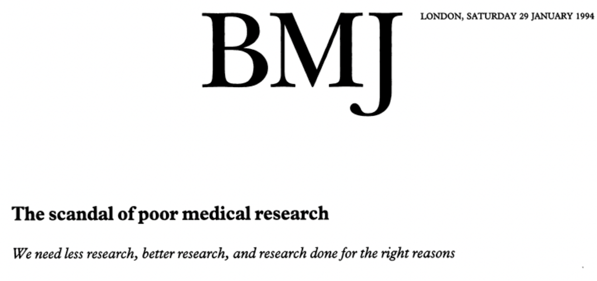
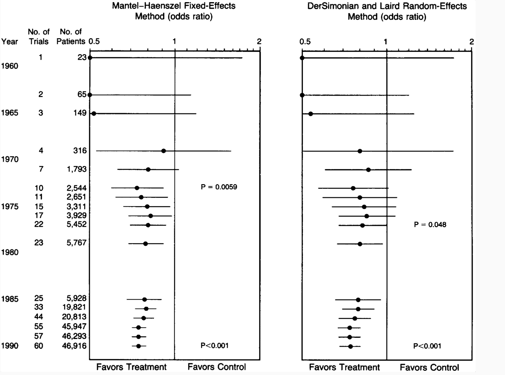
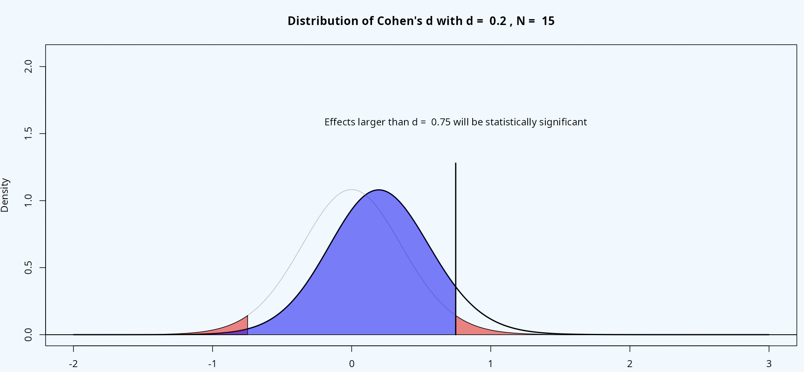
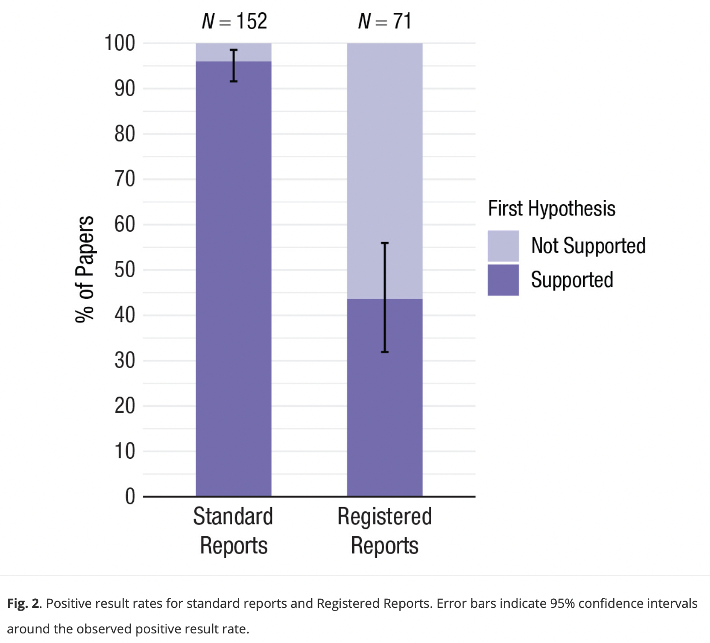
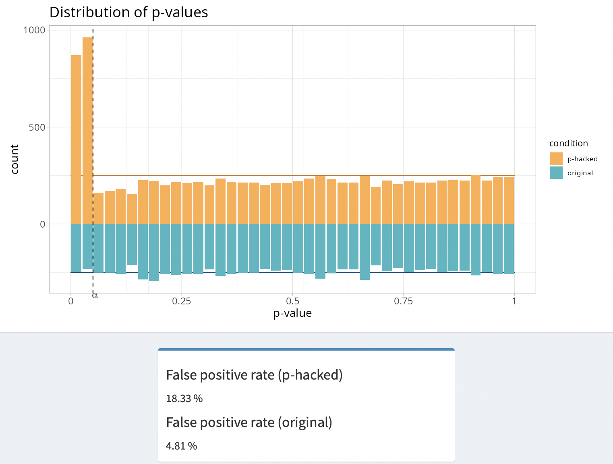
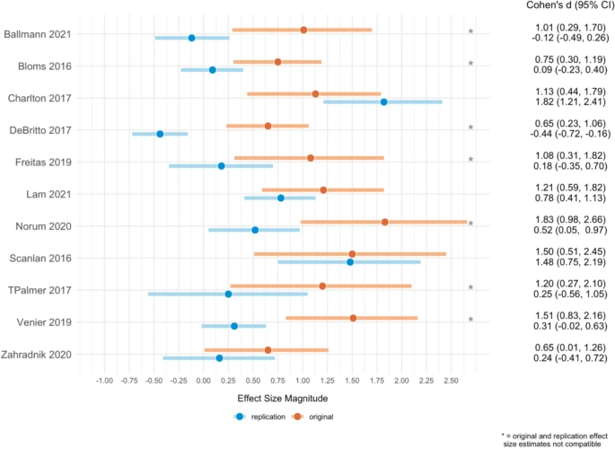
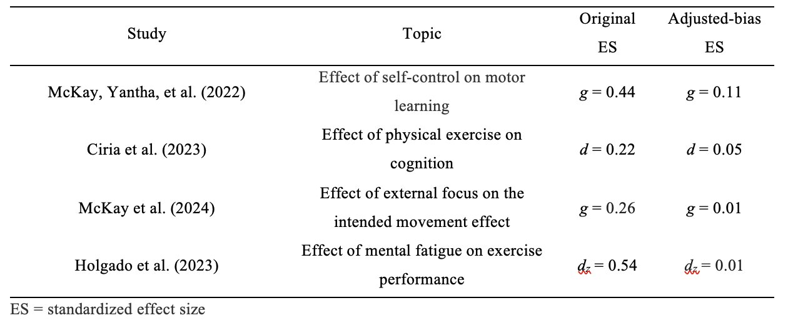
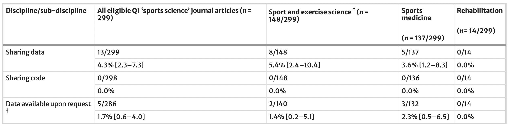

```{r setup, include=FALSE}
knitr::opts_chunk$set(echo = FALSE)
```

# Discussion points

-   Declaration of Helsinki

-   Informative research vs. research waste

-   Types of research waste

-   Reasons for research waste

-   Potential solutions

# Declaration of Helsinki: What it is

-   The Declaration was developed in 1964 by the World Medical
    Association

-   It serves as the international benchmark for ethical conduct in
    human research, providing high-level principles that guide
    regulatory bodies, research institutions, and individual researchers

## 

How many of you do know the content of the Declaration of Helsinki?

## 

How many of you have declared to adhere to the Declaration of Helsinki?

# Declaration of Helsinki 2013

**12.** Medical research involving human subjects must be conducted only
by individuals with the appropriate ethics and scientific education,
training and qualifications. Research on patients or healthy volunteers
requires the supervision of a competent and appropriately qualified
physician or other health care professional [@helsinky_2013]

# Declaration of Helsinki 2013

**21.** Medical research involving human subjects must conform to
generally accepted scientific principles, be based on a thorough
knowledge of the scientific literature, other relevant sources of
information, and adequate laboratory and, as appropriate, animal
experimentation. [...] [@helsinky_2013]

# Declaration of Helsinki 2024

**21.** Medical research involving human participants must have a
scientifically sound and rigorous design and execution that are likely
to produce reliable, valid, and valuable knowledge and avoid **research
waste** [...] [@helsinky_2025]

# Declaration of Helsinki 2024

**36.** Researchers, authors, sponsors, editors, and publishers all have
ethical obligations with regard to the publication and dissemination of
the results of research. Researchers have a duty to make publicly
available the results of their research on human participants and are
accountable for the timeliness, completeness, and accuracy of their
reports. All parties should adhere to accepted guidelines for ethical
reporting. Negative and inconclusive as well as positive results must be
published or otherwise made publicly available [@helsinky_2025]

# Informative research

-   The process of gathering and analyzing data to produce trustworthy
    knowledge

-   It is carried out through ethical and rigorous methods, and
    communicated transparently and without bias, enabling peers to
    verify and build upon the findings

# Why do we do research?

-   To test the the efficacy/effectiveness of interventions

-   Is intervention A more effective than intervention B in reducing
    time to return-to-play in football players after injury?

# Research waste

Research that fails to produce reliable or relevant results that cannot be be used to inform decision making

# Research waste

```{r out.width="70%", fig.align ="center"}

```

[@altman_scandal_1994]

# Waste at four stages of research

Question -\> Design and analysis -\> Reporting -\> Publication

# 1-Research question

-   Irrelevant/low priority questions addressed

-   Redundancy

# Example: Cumulative Meta-Analysis of Therapeutic Trials for Myocardial Infarction [@lau_cumulative_1992]

-   Thirty-three trials evaluating this therapy were performed between
    1959 and 1988

-   Statistically significant reduction in mortality (odds ratio, 0.74;
    95% CI [0.59 to 0.92]) was achieved in 1973, after only eight trials
    involving 2432 patients

-   The results of the 25 subsequent trials (34,542 additional patients)
    through 1988 had little or no effect on the odds ratio establishing
    efficacy, but simply narrowed the 95% CI

-   Two very large trials in 1986 (11,712 patients) and in 1988 (17,187
    patients) did not modify the already established evidence of
    efficacy

# Cumulative Meta-Analysis of Therapeutic Trials for Myocardial Infarction

```{r out.width="80%", fig.align ="center"}

```

[@lau_cumulative_1992]

# Example in sports and exercise science: The effect of self-talk interventions on sports/motor performance

-   Since @hatzigeorgiadis_2011 meta-analysis the number of studies
    conducted examining the effects of self-talk interventions on
    sport/motor performance has roughly doubled

-   35 new studies published from November 2011 up to November 2023

-   The overall effect in @hatzigeorgiadis_2011 was 0.48 95% CI (0.38;
    0.58) and after adding newer studies the overall effect was 0.47 95%
    CI (0.39; 0.56) in @steele_waste_2024

# Relevant research question

New research should be set in the context of an evidence gap and should
involve stakeholders when possible

# 2- Study design

Conduct studies that do not answer the research question
[@mesquida_what_is_your_hypo]. For instance:

-   23 out of 350 studies tested a hypothesis of equivalence using a
    classic null hypothesis test [@mesquida_zcurve_2025]

-   Testing for treatment effects by separate analyses of changes from
    baseline in each group is a misleading approach

```{r out.width="60%", fig.align ="center"}
knitr::include_graphics("figures/fig10.pdf")
```

# 2- Study design

Invalid a priori power analyses [@mesquida_power_analysis_2025]:

-   Mean sample size of \~ 30 participants

-   40% (139 out of 350) of hypothesis-testing studies reported
    conducting an a priori power analysis.

-   No significant difference in sample size between studies that
    reported an a priori power analyses and those that did not

-   No significant difference in the proportion of hypotheses supported
    between studies that reported an a priori power analyses and those
    that did not

-   Potential reasons: sample size bamba [@sample_size_bamba], invalid
    effect sizes, inflated effect sizes

# How a power analysis implicitly reveals the smallest effect size you care about

```{r out.width="80%", fig.align ="center"}

```

# 2- Study design

-   **Low statistical power**: an analysis of 269 hypothesis-testing
    studies showed that the average statistical power was 11%
    [@mesquida_zcurve_2025]

-   **Implication**: With such low power, the chance of detecting true
    effects is extremely low

-   Flipping a coin (50% probability).

# Why designing studies with high statistical power is important?

1- Interpretation of null findings

-   If a study is designed with low power (e.g., 20%), a null
    significant result cannot be interpreted because it could be due to
    that the effect size is smaller than expected or non-existent.

# Why designing studies with high statistical power is important?

2- Narrower confidence intervals

```{r echo=FALSE}
set.seed(0)                  # for reproducibility

group1 <- rnorm(10, 0, 1)    # simulate sample 1
group2 <- rnorm(10, 0.5, 1)  # simulate sample 2

result <- t.test(            # Welch's t-test by default
  group1, 
  group2, 
  var.equal = FALSE
  )  

group2 <- rnorm(100, 0, 1)    # simulate sample 1
group3 <- rnorm(100, 0.5, 1)  # simulate sample 2

result2 <- t.test(            # Welch's t-test by default
  group2, 
  group3, 
  var.equal = FALSE
  )  
```

-   Example 1: study with 20 participants yields a wider 95% CI
    [`r round(result$conf.int[1],2)`; `r round(result$conf.int[2],2)`]

-   Example 2: study with 200 participants yields a narrower 95% CI
    [`r round(result2$conf.int[1],2)`;
    `r  round(result2$conf.int[2],2)`]

# 2- Study design

Lack of transparency

-   Framing your study as confirmatory when is exploratory
    [@ditroilo_exploratory]

-   Vague and unfalsifiable hypotheses [@mesquida_what_is_your_hypo]

# 3- Selection bias

-   Publication bias

-   Flexibility in data analysis

```{r out.width="60%", fig.align ="center"}
knitr::include_graphics("figures/fig4.pdf")
```

[@mesquida_zcurve_2025]

# Publication bias

```{r out.width="60%", fig.align ="center"}

```

[@scheel_excessive]

# Flexibility in data analysis

```{r out.width="60%", fig.align ="center", fig.cap="Distribution of effect sizes under the null hypothesis when performing 5 indepdendent t-tests, the correlation between dependent variables is 0.5 and alpha level is 0.05"}

```

# Selection bias and statistical power in sports and exercise science

```{r out.width="60%", fig.align ="center"}
knitr::include_graphics("figures/fig7.pdf")
```
[@mesquida_zcurve_2025]

# Consequences of selection bias and studies with underpowered designs

```{r out.width="70%",fig.align ="center"}

```
[@murphy_replicability_2025]

# Results of the Sports Science Replication Project [@murphy_replicability_2025]

-   Inflated type I error rate: 56% of the 25 analysed replication
    studies had a statistically significant p-value similar to the
    original studies

-   Inflated effect sizes: median percentage decrease in magnitude from
    the original to the replication effect size estimate equal to 75%
    for all of the replication effect sizes

-   Only 36% of replication and original effect size estimates were
    compatible

# Results from other meta-scientific studies

```{r table1, out.width="90%",fig.align ="center"}

```

# 4- Reporting of statistical information and data sharing

-   "This project faced many practical challenges when preparing studies
    for replication, specifically the poor reporting of statistical
    information, the availability of original raw data [...] "
    [@murphy_reflections]

-   Out of 350 hypothesis-testing hypotheses, 57% (46/81) could not be
    recomputed into an exact p-value due to poor reporting of
    statistical information or availability of original raw data
    [@mesquida_zcurve_2025]

# 4- Reporting of statistics and data sharing

```{r out.width="100%",fig.align ="center"}

```

[@borg_sharing_practices]

# Why sharing data and code are important?

-   Verify results: Allow peers to reproduce and confirm the findings

-   Reuse data: Facilitate meta-analyses, replications, secondary
    analyses, or new research projects

-   Increase transparency: Promote trust and accountability in research

# Research waste also affect meta-analyses

In the 30 most cited meta-analyses in S&C research, @kadlec_2023 found
that:

-   Almost 45% contained at least one effect size that was mistakenly
    calculated using SE rather than SD.

-   45% failed to account for effect size dependency

In 96 meta-analyses published in Sports Medicine, @mesquida_metaanalyses
found that:

-   16% of 96 meta-analyses contained data to reproduce study effect
    sizes

-   Many combined studies with different designs (e.g., within- and
    between-designs, RCT and non-RCT)

-   34% did not account for effect size dependency

# Summary

-   Research waste in the form of studies that do not answer the
    research question, inflated effect sizes, study designs with low
    power, poor reporting of statistical practices and lack of data
    sharing and low methodligical quality of meta-analyses

-   We, as a community, are not properly trained to conduct informative
    research

# Drivers of research waste

Wrong incentives:

-   Quantity vs. quality: mass produce sports and exercise science
    research for career purposes

-   Preference for studies that report positive findings

-   Compete for limited resources

# Drivers of research waste

-   Time constraints: lack of time to develop expertise and skills

-   Incompetence: insufficient training

# How to avoid research waste

```{r out.width="90%",fig.align ="center"}
knitr::include_graphics("figures/fig9.pdf")
```

# Long-term solutions

-   Reward researchers not for the number of publications but for the
    quality of their research

-   More time for improving research competences

-   Improve statistical training at BSc and MSc

# How to avoid research waste

Mid-term solutions

-   Science as a collaborative effort where each member brings
    specialized expertise

-   Big Team Science

Question -\> Design -\> Analysis Plan -\> Data collection -\> Analysis
execution -\> Reporting -\> Interpretation -\> Data stewardship

# Science as a collaborative effort

-   The goal is not to conduct experiments alone or with small group of
    collaborators which may lack expertise in some areas

-   The goal is to support and ehance collective scientific research

# Science as a collaborative effort

-   Theorists -\> develop frameworks or hypotheses to explain phenomena
-   Methodologists -\> statisticians -\>design studies and slect
    appropiate methods
-   Data collectors -\> gather and organize raw data
-   Experts in interpreting effect sizes -\> assess the practical
    significance of findings
-   Data stewards -\> manage, curate and maintain datasets to ensure
    FAIR principles and reproducibility

# Specialization

-   **12**. Medical research involving human participants must be
    conducted only by individuals with the appropriate ethics and
    scientific education, training and qualifications. Such research
    requires the supervision of a competent and appropriately qualified
    physician or other researcher [@helsinky_2025]

# How to avoid research waste

Short-term solutions

-   Collaboration with applied statisticians [@sainani_collaboration]

-   Registered Reports (?)

# References {.allowframebreaks}
