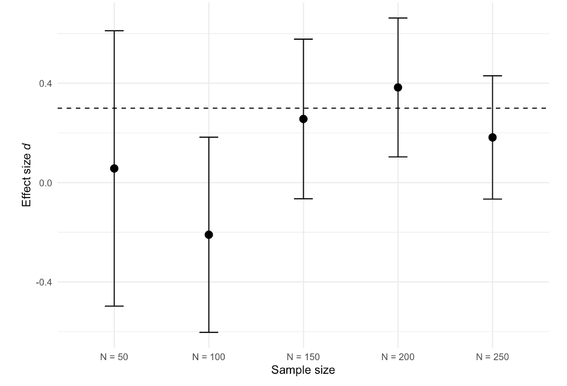
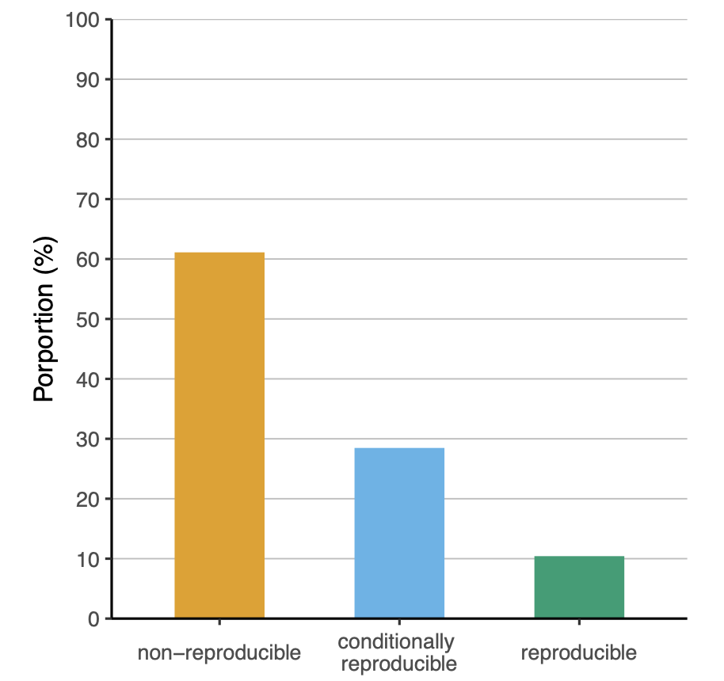
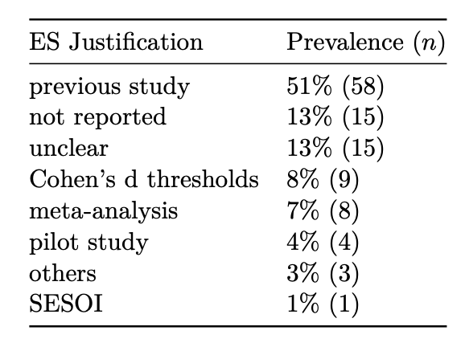
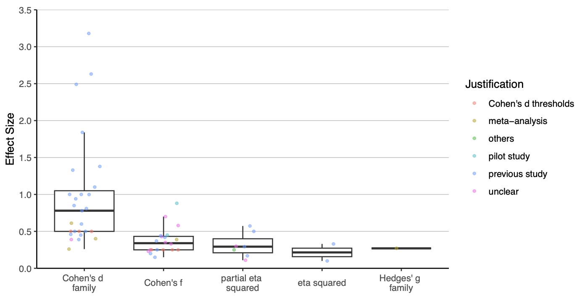
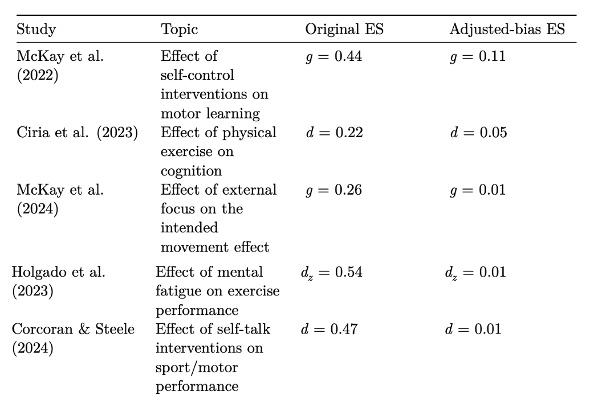
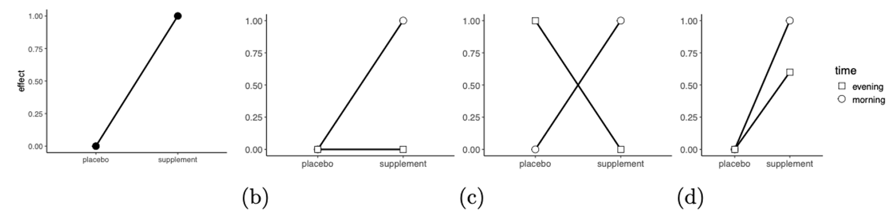

## Overview

- The importance of statistical power
- The current state of power analysis in sports and exercise science
- Strategies for improvement

## How to design informative studies?

::: {.fragment fragment-index="1"}
- Address relevant questions
:::

::: {.fragment fragment-index="2"}
- Use rigorous study designs
:::

::: {.fragment fragment-index="3"}
- Apply appropriate statistical analysis
:::

::: {.fragment fragment-index="4"}
- Controlling for type I and type II error rates in the Null-hypothesis testing framework
:::

## How do we control the type II error rate?

By conducting an a priori power analysis

::: {.fragment fragment-index="1"}
$$n = 2 * (\frac{Δ}{\sigma})^2 * (Z_{\alpha/2} + Z_{\beta})^2$$
:::

::: {.fragment fragment-index="2"}
- $n$: the number of participants

- Δ: the expected difference

- $\sigma$: the presumed standard deviation

- $\alpha$ : the probability of type I error

- $\beta$: the probability of type II error
:::

## Studies designed with inadequate power can be unethical

::: blockquote
"21. Medical research involving human participants must have a scientifically sound and rigorous design and execution that are likely to produce reliable, valid, and valuable knowledge and avoid research waste." <br> **— [@helsinky_2025]**
:::

## Designing studies with high statistical power increase the informative value of studies

## 1- Increased probability of detecting true effects

- Design a study that has a high probability of detecting the intervention effect of interest

- That is, you do not want to fail to develop a new treatment

## 2- More informative non-significant results

- **Study A** designed with 90% to detect Δ yields a null finding ($p$ \> $\alpha$)

- **Study B** designed with 30% to detect Δ yields a null finding ($p$ \> $\alpha$)

- What can we learn from **study A** and **study B**?

## 3- Reduced uncertainty (narrower 95% CI)

```{r fig.align ="center", out.width="70%"}

```

## Most studies are designed with low-statistical power

In a sample of 350 hypothesis-testing studies:

- Typical sample size in the field is about 35 participants [@mesquida2025]

- Average statistical power of 11% [@mesquida]

## Why statistical power is so low?

- Assess the prevalence, reproducibility and quality of power analyses [@mesquida2025]

- 350 hypothesis-testing studies published across 10 journals

## Low prevalence

### About 40% of hypothesis-testing studies reported an a priori power analysis [@mesquida2025]

## Low reproducibility

```{r fig.align ="center", out.width="90%"}

```

## Low reproducibility

- Studies often failed to report all required information

- Statistical test and selected effect size were often missing

## Justification of effect sizes

```{r fig.align ="center", out.width="70%"}

```

## Distribution of effect sizes in power analysis

```{r fig.align ="center", out.width="60%"}

```

## Quality

- If sample sizes are so small (\~35), shouldn't we expect that including an a priori power analyses will lead to larger sample sizes?

- Reporting an a priori power analysis was not associated with larger sample sizes or a higher proportion of supported hypotheses

## Potential reasons

- A priori power analyses are conducted in a way that yields the sample size researchers aim to recruit — also known as "sample size samba" — [@schulz2005]

## Potential reasons

- Inflated effect sizes [@murphy2025]
  - Low statistical power + selection bias → inflated effect sizes

  - A median decrease of 75% in replicated effect sizes compared to the original findings [@murphy2025]

## 

Results of the Sport Science Replication Project [@murphy2025]

```{r fig.align ="center", out.width="90%"}
knitr::include_graphics("figures/results_ssrp.png")
```

## Inflated ES in meta-analyses

```{r fig.align ="center", out.width="80%"}

```

## Potential reasons

- Using an effect size estimate that does not match the intervention effect (difference across the PICOS dimensions; estimand)

- Using a statistical test that does not match statistical test used to evaluate the hypothesis

## How to improve the quality of power analysis?

::: {.fragment fragment-index="1"}
- Better training
  - Sampling variability
  - Critical effect size
  - Improve justification/interpretation of effect sizes
  - PICOS/estimand framework
  - Automatation
:::

::: {.fragment fragment-index="2"}
- More collaboration with (applied) statisticians and experts
:::

## The biggest challenge

- The true Δ is unknown, so researchers need to make an assumption about the true size of Δ

## Expected Δ

- Because Δ is unknown, researchers need to assume it

- Sports scientists often rely on single studies, meta-analysis or pilot studies

- However, each of these approaches comes with its own limitations

## Estimated Δ vs. population Δ

- We collect a **sample** from a larger population
- Effect sizes from a study are **estimates** of the true population effect
- Estimates vary due to sampling error
- Smaller samples → more sampling error
- More sampling error → less precise effect size estimates

## Population Δ = 0.5

```{r}
set.seed(123)

library(ggplot2)
library(effectsize)

sim <- function(n){
  group1 <- rnorm(n, 0.5, 1)
  group2 <- rnorm(n, 0, 1)
  d <- cohens_d(group1, group2)$Cohens_d
}

d_rep <- replicate(100, sim(30))

d_rep |> 
  as.data.frame() |>  
  dplyr::rename(d = 1) |> 
  ggplot(aes(x = d, y = "Cohen's d")) +
  ylab(NULL) +
  geom_vline(xintercept = 0.5) +
  geom_jitter() +
  ggtitle("Distribution of effect sizes generated using a two independent-group design with N = 30 and a true effect of 0.5")
```

## Critical effect size

- The smallest detectable effect that can reach statistical significance [@perugini2025]

- Its value depends on the given sample size, $\alpha$, and test statistic

- The typical sample size in sports and exercise science is \~30 participants

- What is the critical effect size for a two-group study with an $N$ of 30 and $\alpha$ of 0.05?

```{r}
#| echo: FALSE

crit_d <- criticalESvalue::critical_t2s(
  m1 = 60, 
  m2 = 57, 
  sd1 = 12, 
  sd2 = 12, 
  n1 = 15, 
  n2 = 15, 
  var.equal = FALSE,
  hypothesis = "greater", 
  conf.level = 0.95
  )

kableExtra::kable(
  dplyr::bind_rows(
    type_effect_size = c("d", "g"), 
    effect_size = round(c(crit_d$d, crit_d$g), 2),
    critical_effect_size = round(c(crit_d$dc, crit_d$gc), 2)
    )
  )
```

## Studies often differ in critical aspects

The **PICOS** framework:

- Population

- Intervention

- Comparator

- Outcome

- Study design/statistical test

## Population

- Elite athletes, highly-trained athletes, sedentary participants, patients, students, etc.

- Intervention effects may vary across populations.

- For example, a training intervention is likely to produce greater performance improvements in untrained or less trained individuals compared to highly trained athletes.

## Intervention

- Dose, intensity, duration, type of intervention, frequency, etc.

- All these variables can impact the intervention effect.

```{r}
library(dplyr)
library(ggplot2)

set.seed(123)

# Time points (months)
time <- 0:12

# Number of participants per group
n <- 30

# Function to generate diminishing returns
growth_curve <- function(t, max_gain, rate) {
  max_gain * (1 - exp(-rate * t))
}

# Simulate data
data <- expand.grid(
  subject = 1:n,
  group = c("1x_week", "2x_week"),
  month = time
)

# Add baseline values
data$baseline <- rnorm(n * 2, mean = 40, sd = 10)

# Assign group-specific parameters
data$gain <- ifelse(
  data$group == "1x_week",
  growth_curve(data$month, max_gain = 20, rate = 0.4),
  growth_curve(data$month, max_gain = 35, rate = 0.4)
)

# Add individual variation + noise
data$strength <- data$baseline +
  data$gain +
  rnorm(nrow(data), 0, 3)

# Summarise to group means
summary_data <- data |> 
  group_by(group, month) |> 
  summarise(mean_strength = mean(strength), .groups = "drop")

# Plot
ggplot(summary_data, aes(month, mean_strength, colour = group)) +
  geom_line() +
  ylab("1-RM")
```

## Comparator

- Placebo, active comparator (standard procedure), no-treatment control, dose-response comparator, historic comparator.
- For example, comparing a new intervention against standard intervention might result in a smaller effect compared with a no-treatment control.

## Outcome

- What outcome was used to measure the impact of the intervention?

- $VO_{2MAX}$, velocity at lactate threshold 2, countermovement jump (CMJ) height, 10-m sprint velocity, etc.

- The same intervention may yield different results depending on the measured outcome.

- For example, plyometric training is likely to improve jump height to a larger extant than 10-m sprint velocity.

## Study design

- Pre-post design, parallel control group design, randomized controlled trial (RCT), etc.

- Different study designs are associated with varying risks of bias; for example, observational studies generally have a higher risk of bias compared to randomized controlled trials (RCTs)

## The effect size depends on the type of interaction

```{r fig.align ="center", out.width="70%"}

```

The interaction effect size can be expressed as a **difference-in-difference**:

$$d_{\mathrm{int}} =
\frac{(E_1 - C_1)}{\mathrm{Pooled\ SD}}
-
\frac{(E_2 - C_2)}{\mathrm{Pooled\ SD}}
=
\frac{(E_1 - C_1) - (E_2 - C_2)}{2 \times \mathrm{Pooled\ SD}}$$

## 

$$ Study_A: d_{\mathrm{int}} = \frac{(1-0) - (0-0)}{2 \times 2} = 0.5 $$ $$ Study_B: d_{\mathrm{int}} = \frac{(1-0) - (0-1)}{2 \times 2} = 0.25 $$ $$ Study_C: d_{\mathrm{int}} = \frac{(1-0) - (0-0)}{2 \times 2} = 0.5 $$ $$ Study_D: d_{\mathrm{int}} = \frac{(1-0) - (0.6-0)}{2 \times 2} = 0.1 $$

## Using the wrong intervention effect

**Study aim**: to determine whether **acute moderate hypoxia**, compared to **normoxia**, had no detrimental effect on power output during 4 x 30-s all-out efforts.

**Sample size justification**:

::: {..blockquote}
"The sample size was estimated using a power analysis software G\*Power (version 3.1.9.2; Bonn University, Bonn, Germany) based on the mean effect (d = 3.18) of the within-condition decrement to peak and mean power output during repeated 30-s Wingate efforts.10 The power analysis resulted in a calculated total sample size of 4 participants."
:::

## How *d* = 3.18 was calculated

```{r fig.align ="center", out.width="60%"}
knitr::include_graphics("figures/hypoxia.png")
```

## Automatation

The `power` module in `Metacheck` can detect and classify power analyses and their components

```{r eval=FALSE, echo=TRUE}

library(metacheck)
llm_use(TRUE) # Set to TRUE to use LLM

result <- module_run(psychsci[10], "power") 
```

# Output

```{r eval=FALSE, echo=TRUE}
# json_expand(result$table$answer) Returns a data frame
result$table$answer
```

::: scroll-code
``` text

[
  {
    "text": "On the basis of simulations over a range of
expected effect sizes for contrasts of fMRI activity, we
estimated that a sample size of 24 would provide .80 
power at a conservative brainwide alpha threshold of 
.002",
    "power_type": "sensitivity",
    "statistical_test": "other",
    "statistical_test_other": null,
    "sample_size": 24,
    "alpha_level": 0.002,
    "power": 0.8,
    "effect_size": null,
    "effect_size_metric": null,
    "effect_size_metric_other": null,
    "software": null
  },
  {
    "text": "The effect size from that study implied 
that a sample size of 72 loan requests would be required
to achieve .80 power at an alpha level of .05",
    "power_type": "apriori",
    "statistical_test": "other",
    "statistical_test_other": null,
    "sample_size": 72,
    "alpha_level": 0.05,
    "power": 0.8,
    "effect_size": null,
    "effect_size_metric": null,
    "effect_size_metric_other": null,
    "software": null
  }
]
```
:::

# Thanks for your attention!

## References
