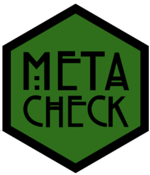
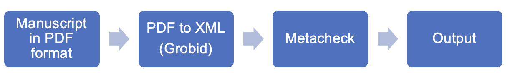
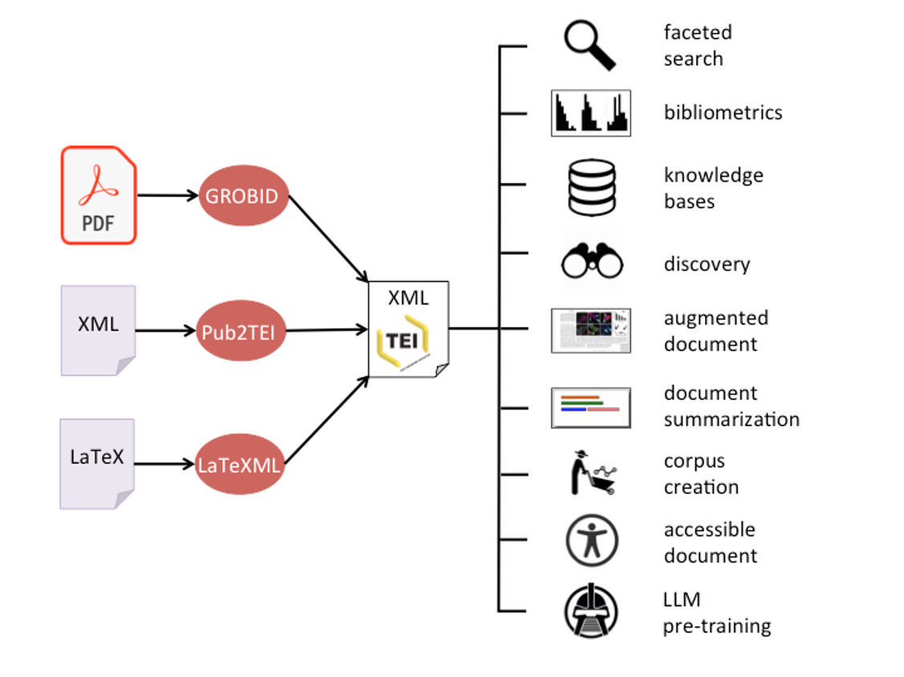
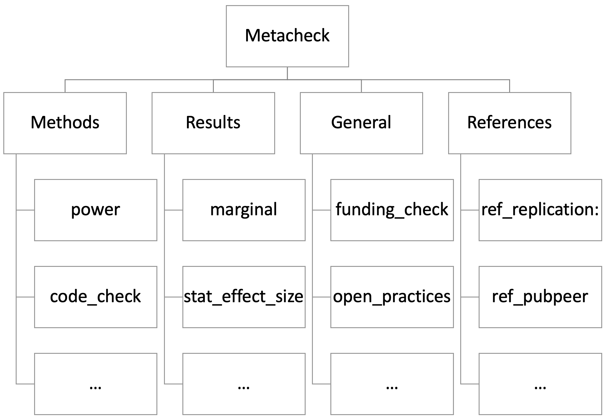
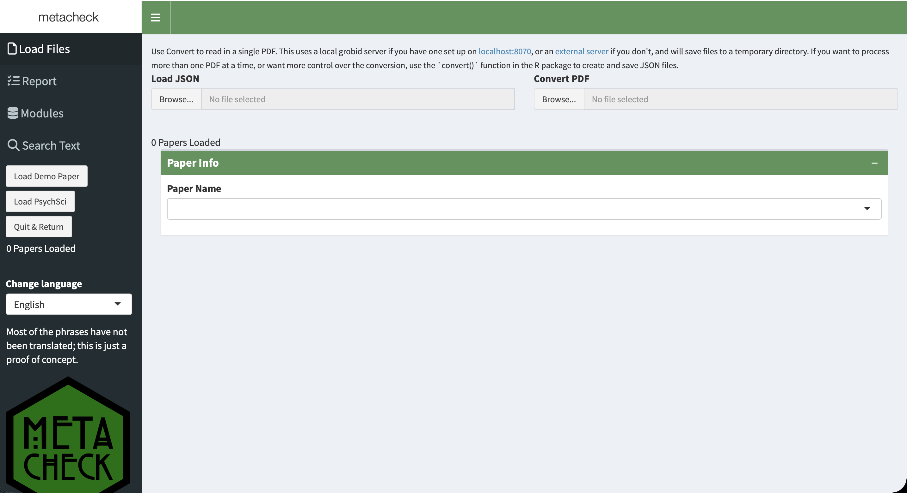
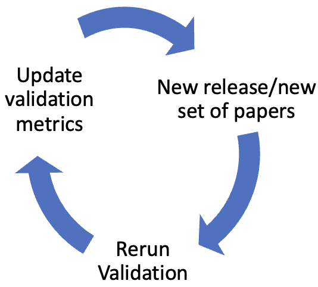
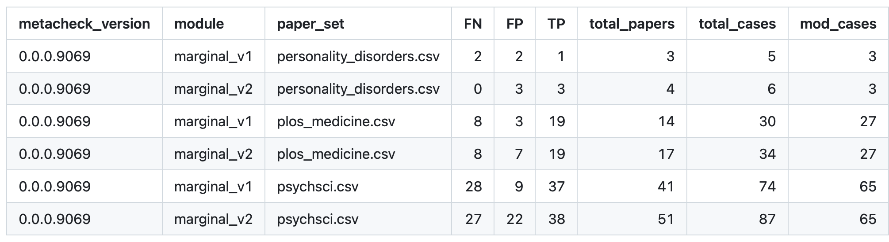
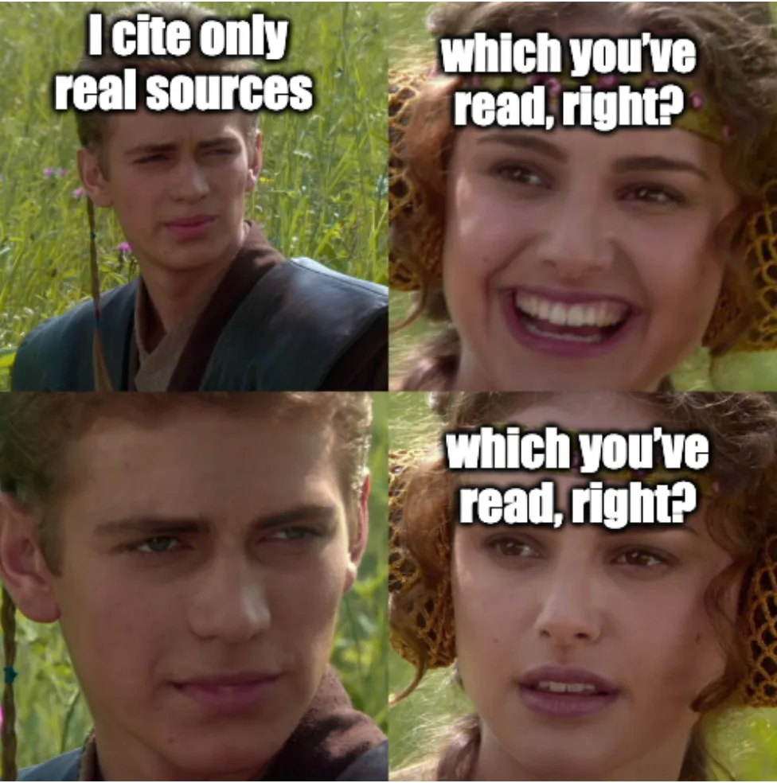

```{r}
#| include: false
library(dplyr)
library(metacheck)
library(shinydashboard)
library(shiny.i18n)

psychsci <- papers_load("psychsci", cache = TRUE)
```

# How do organizations ensure quality control?

:::: fragment
::: {style="color:red; font-size:2em;"}
Applying quality management systems, such as **ISO 9001**
:::
::::

## A key requirement of **ISO 9001:2015** is that:

:::: fragment
::: {style="color:green; font-size:2em;"}
Workers are competent
:::
::::

# Competence is ensured through appropriate education, training, or experience

# However

- Science lacks effective systems for quality management
- Limited time for education, training or developing new skills

# 

These factors contribute to several recurring issues in scientific research, including:

- Poor adherence to reporting guidelines [@kazak_2018]
- Misinterpretation of non-significant results [@aczel2018; @murphy_2025]
- Non-reproducible a priori power analyses [@mesquida_2025; @thibault_errors_power]
- Lack of computational reproducibility [@miske_2026]
- Miscitations [@cobb_miscitation_2024]

## What do these issues have in common? 

:::: fragment
::: {style="color:red; font-size:2em;"}
They can be automatically detected
:::
::::

## What can we do from a human factor perspective?

:::: {.fragment .r-fit-text}
::: {style="color:red;"}
Automation
:::
::::

## Automation in sofware development

- Automated checks are used to identify issues before release
- For example, before submitting a package to CRAN, a battery of tests must be passed:

:::: {.fragment fragment-index=1}
::: {style="color:black;"}
CRAN is checking
:::
::::

:::: {.fragment fragment-index=1}
::: {style="color:green;"}
- [X] package namespace information 
:::
::::

:::: {.fragment fragment-index=2}
::: {style="color:green;"}
- [X] package dependencies
:::
::::

:::: {.fragment fragment-index=3}
::: {style="color:green;"}
- [X] package directory
:::
::::

:::: {.fragment fragment-index=4}
::: {style="color:green;"}
- [X] Status: OK
:::
::::


## CRAN not only checks for warnings

::: {.fragment}
<div style="color:red; font-size:1.4em;">
  ✗ drawImage: no visible global function definition for ‘Axis’
</div>
:::

## But also provides suggested fixes
::: {.fragment style="color:blue; font-size:1.4em;"}
Replace it with axis()
:::

#

```{r fig.align ="center", out.width="90%", fig.show="hold"}

```

## `metacheck`

- An R package containing modules to automate checks in manuscripts

- Each module performs a certain task

- Combines text search, code, and large language models to assess adherence to — or deviations from — scientific best practices

- Can be applied to individual manuscripts or sets of manuscripts

# Two core values in `metacheck`:

[ **Quality Control**: The knowledge, data, code, and software we create will 
be **verified** for accuracy using publicly available methods and measures, 
\[...\]. ]{style="font-size:1.6em; font-weight:150;"}

# 

[ **AI Optional**: The use of large language models will be restricted to 
**classification**, not evaluation of the quality of practice. The use of LLMs
will always be **opt-in** and transparently declared.
\[...\]. ]{style="font-size:1.6em; font-weight:150;"}

# Workflow

```{r fig.align ="center", out.width="80%", fig.show="hold"}

```

# Grobid

```{r fig.align ="center", out.width="80%", fig.show="hold"}

```

## `metacheck` modules

```{r fig.align ="center", out.width="80%", fig.show="hold"}

```

## `marginal` module

`marginal` detects statements about marginally significant results

```{r, echo = TRUE}
(res_marginal <- module_run(psychsci[[13]], "marginal"))
```

## `marginal` module output

```{r echo = TRUE}
res_marginal$table
```

## `stat_effect_size` module

`stat_effect_size` checks whether *F*-tests and *t*-tests have been reported with an effect size


```{r echo = TRUE, }
(res_stat <- module_run(psychsci[[250]], "stat_effect_size"))
```

# `stat_effect_size` module output

```{r echo = TRUE}
res_stat$table |> 
  select(es, test_text) # We could also select `text`, which returns the sentence where the effect size was detected—or is missing.
```

## `stat_p_exact` module

`stat_p_exact` detects statements about imprecisely reported *p*-values

```{r echo = TRUE}
(res_exact <- module_run(psychsci[[110]], "stat_p_exact"))
```

## `stat_p_exact` module output

```{r echo = TRUE}
res_exact$table |> 
  filter(imprecise == TRUE) |> 
  select(text, section_type, expanded)
```

## Batch processing

```{r echo = TRUE}
res_exact <- psychsci[3:4] |> 
  module_run("stat_p_exact")

res_exact$summary_table[, c(1, 2)]
```

# 

```{r echo = TRUE}
(res <- res_exact$table |> 
  filter(imprecise == TRUE) |> 
  select(text, paper_id, section_type, expanded))
```

# 

```{r echo = TRUE}
res$expanded[2]
```

## Module chain

More than one module can be applied at once

```{r echo=TRUE}
module_chain <- psychsci[3:4] |>  
  module_run("marginal") |> 
  module_run("stat_p_exact")

module_chain$summary_table[, c(1:3)]
```


## Current state of power analysis statements

"A power analysis indicated that a sample size of 60 participants was required to achieve 80% power"

- Power analysis statements are often poorly reported

  - e.g., what effect size was assumed? 
  - e.g., what statistical test was used?

- Lack of transparency hinders reproducibility and scrutiny
  
# `power` module

- `power` detects power analysis statements and assesses their completeness 

- `power` uses an opt-in LLM to classify the information contained in the statement

## No LLM

```{r echo = TRUE}
llm_use(FALSE) 

res_power <- module_run(psychsci[150], "power")

res_power$table |> 
  select(text, power_type)
```

## Classification result

Classified as **unknown** because there is no information about the type of power analysis reported

```{r echo = TRUE}
res_power$table$text[1]
```

## LLM used to classify inputs and return results in a structured JSON format:

<pre style="font-size: 0.8em; line-height: 1.4;">
<code>{
  "power_type": true,
  "statistical_test": "paired t-test",
  "sample_size": 20,
  "alpha_level": 0.05,
  "power": 0.8,
  "effect_size": 0.4,
  "effect_size_metric": "Cohen's d",
  "software": "G*Power"
}</code>
</pre>

## With LLM option

```{r echo = TRUE}
paper <- psychsci[150]

llm_use(TRUE)
llm_model("groq/openai/gpt-oss-120b")
power_results <- module_run(paper, "power")

power_results$table |> 
  select(text, power_type:effect_size_metric) 
```

##

The `power` module assesses the completeness of power analysis statements


```{r echo = TRUE}
power_results$table$complete
```

## Our `power` module is a bit of a wizard

`power` can detect and classify several power analyses in a paragraph

```{r echo = TRUE}
paper <- psychsci[10]

llm_use(TRUE)
llm_model("groq/openai/gpt-oss-120b")
power_results <- module_run(paper, "power")
```


```{r}
power_results$table |> 
  select(text, power_type, statistical_test, sample_size:power)
```

## `metacheck` as a shiny app

`metacheck_app()`

```{r fig.align ="center", out.width="90%", fig.show="hold"}

```

# [Metacheck report](https://www.scienceverse.org/metacheck/report-example.html)

## Validation of `metacheck` modules

- Create ground-truth data sets
- Module validation
- Validation as a reproducible and reusable workflow

```{r fig.align ="center", out.width="70%", fig.show="hold"}

```

## Module validation output

Validation results of the `marginal` module

```{r fig.align ="center", out.width="70%", fig.show="hold"}

```

# Ongoing projects

## Miscitations

```{r fig.align ="center", out.width="70%", fig.show="hold"}

```

## Miscitations in pyshcology

Cobb et al. -@cobb_miscitation_2024 found that out of 3,347 citations:

- ~81% were accurate 

- ~9% failed to include important nuances of results

- ~10% completely mischaracterized original findings

## `miscitation` module

- Create a database of commonly miscited papers

- Authors can log papers that are frequently miscited

- `miscitation` detects citations included in the database and provides guidance on how it should be cited

# 

[Would scientists value receiving a `metacheck` report when sharing a preprint?]{style="font-size:1.6em; font-weight:150;"}

[Would they consider it reliable?]{style="font-size:1.6em; font-weight:150;"}


## Reactance and trust to `metacheck`

Assess peer reactions to `metacheck` reports, with a focus on:

  - Trust in automated assessments

  - Perceived usefulness

  - Willingness to use or adopt `metacheck`

# Reach out!

[ We are happy to work with you on using `metacheck` for metascience, or to create community-specific modules! ]{style="font-size:1.6em; font-weight:400;"}

# `metacheck` team

```{r fig.align ="center", out.width="90%", fig.show="hold"}

```

## Project funder

`metacheck` is partly financed by the Dutch Research Council (NWO) via the Thematic Digital Competence Centre Social Sciences & Humanities (TDCC-SSH) as part of the project Research Transparency Check (ICT.001.TDCC.018) under the grant https://doi.org/10.61686/ENWVD61320.

## Conference funder

[TU/e Center for Humans and Technology]{style="font-size:2em; font-weight:150; color:red;"} 


# Thanks!

# References